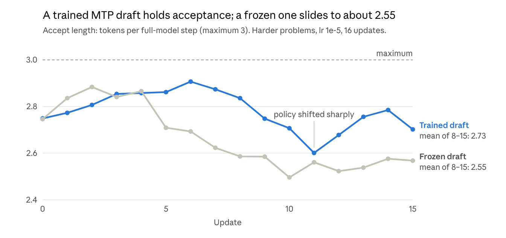

# Fused LM head and MTP training

Validated 2026-10-23 and 2026-10-24 · branch `codex/tiled-lm-head`, based on fork main `d07b58e0`

## Summary

Every correctness check passed. `--log-probs-backend fused_lm_head` matches `fused` across dense, MoE and
MTP layouts, and MTP training through it works end to end in SFT and in RL with SGLang drafting from the
trained MTP head. Testing found and fixed two latent bugs in the head; the 122B real model and fully async
RL are not yet tested.

## What changed

The new backend never holds a microbatch of logits. Megatron's GPT model returns its final hidden states,
and the loss projects only the scored rows, a tile at a time, through the existing `fused` Triton op. Under
gradients each tile is checkpointed and recomputed in the backward. With `--enable-mtp-training`, Megatron's
MTP loss goes through the same tiles.

| Flag | Meaning |
| --- | --- |
| `--log-probs-backend fused_lm_head` | The bounded-memory head. Megatron only, `--loss-type policy_loss` or `sft_loss`. |
| `--log-probs-chunk-size N` | Rows per tile under `fused_lm_head`; required and positive. 4096 is a starting point. |
| `--lm-head-logits-dtype {model,fp32}` | `fp32` accumulates and returns each logits tile in FP32 from bf16 operands. It applies to the MTP loss too. |

| File | Change |
| --- | --- |
| [`miles/backends/megatron_utils/lm_head.py`](../miles/backends/megatron_utils/lm_head.py) | New. A per-forward `LMHeadCapture` through Megatron's `output_processor` hook; the projection in model and FP32 modes, including frozen weights; `_WeightGradReady`, which completes Megatron's DDP gradient bookkeeping after the checkpointed tiles; the tiled MTP loss through Megatron's linear cross-entropy branch (`install_mtp_loss`); `setup_lm_head` startup checks and logging. |
| [`miles/backends/training_utils/loss/hub/lm_head.py`](../miles/backends/training_utils/loss/hub/lm_head.py) | New. `LMHeadInputs`, the backend-neutral `LMHeadProjection` protocol, and `zero_loss_anchor` for ranks with nothing to score. |
| [`miles/backends/training_utils/loss/hub/tiled_lm_head.py`](../miles/backends/training_utils/loss/hub/tiled_lm_head.py) | New. Tiled log-probs and entropy over the scored rows, and tiled cross-entropy for the MTP loss. |
| [`miles/backends/training_utils/loss/hub/logit_processors.py`](../miles/backends/training_utils/loss/hub/logit_processors.py) | Dispatches `fused_lm_head`; shares the response-row layout with `fused`. |
| [`miles/backends/training_utils/loss/hub/losses.py`](../miles/backends/training_utils/loss/hub/losses.py) | Empty-rank anchors use `zero_loss_anchor`. |
| [`miles/backends/training_utils/loss/objective.py`](../miles/backends/training_utils/loss/objective.py) | `--recompute-loss-function` passes the hidden states as an explicit tensor; the all-gather CP anchor uses `zero_loss_anchor`. |
| [`miles/backends/megatron_utils/model.py`](../miles/backends/megatron_utils/model.py) | Builds a capture per forward in training and no-grad scoring, runs the forward under it, and calls `setup_lm_head` for the actor. |
| [`miles/utils/arguments.py`](../miles/utils/arguments.py) | The new flags and their startup validation: rejects other backends and losses, a non-positive tile size, `--allgather-cp`, LoRA, GSPO, OPSM, OPD, `--overlap-moe-expert-parallel-comm`, true on-policy mode and sampling-support replay. |
| [`docs/user-guide/cli-reference.md`](../docs/user-guide/cli-reference.md) | Rows for the new flags. |

## Tests

| Test file | Covers | GPUs |
| --- | --- | --- |
| [`tests/fast-gpu/test_fused_lm_head.py`](../tests/fast-gpu/test_fused_lm_head.py) | New. Head-level checks on TP1, TP2 and TP2 with sequence parallelism | 2 |
| [`tests/e2e/megatron/fused_lm_head_harness.py`](../tests/e2e/megatron/fused_lm_head_harness.py) | New. The comparison both layout files share | — |
| [`tests/e2e/megatron/test_fused_lm_head_layouts.py`](../tests/e2e/megatron/test_fused_lm_head_layouts.py) | New. Eight dense and MTP layouts | 4 |
| [`tests/e2e/megatron/test_fused_lm_head_moe.py`](../tests/e2e/megatron/test_fused_lm_head_moe.py) | New. Four MoE layouts with router replay, one with MTP | 8 |
| [`tests/fast/utils/test_arguments.py`](../tests/fast/utils/test_arguments.py) | Argument validation for the new flags | CPU |
| [`tests/fast/backends/megatron_utils/test_lora_model_branches.py`](../tests/fast/backends/megatron_utils/test_lora_model_branches.py), [`test_model.py`](../tests/fast/backends/megatron_utils/test_model.py) | Hand-built args gain `log_probs_backend` | CPU |
| [`tests/manual/bench_fused_lm_head.py`](../tests/manual/bench_fused_lm_head.py) | New. Time and memory per backend on one GPU | 1 |

Run them in the pinned Miles image on a node with 8 GPUs:

```bash
python -m pytest tests/fast-gpu/test_fused_lm_head.py tests/e2e/megatron/test_fused_lm_head_layouts.py \
  tests/e2e/megatron/test_fused_lm_head_moe.py tests/fast/utils/test_arguments.py
python tests/manual/bench_fused_lm_head.py --rows 65536 --hidden 3072
```

The final regression run passed 1,260 tests, including `tests/fast/backends/megatron_utils` and the loss
suites. Its 4 failures are the hand-built-args row under [Bugs found](#bugs-found). The real-model and
end-to-end scripts are not in the repo; they and their logs live in the ABCI scratch area under
`lm-head-tests/` (`mtp_real/` for the 9B MTP check, `mtp_e2e/` for SFT and RL).

## Validation

### Head-level tests

Every check passes on TP1, TP2 and TP2 with sequence parallelism, projecting through a real Megatron
`ColumnParallelLinear` with a `main_grad` buffer.

| Check | Compared against | Result |
| --- | --- | --- |
| Log-probs and entropy, model mode | `fused` on the same layer's logits; exact-grid inputs; 1-, 7- and 4,096-row tiles; THD and BSHD | Bitwise equal; gradients within 1% of `fused` and 2% of an fp64 reference |
| FP32 logits mode | Same, plus inputs where bf16 rounding matters (logits near 320) | Within 1e-6 of `fused`; within 1e-3 of fp64 where model mode is off by more than 0.05 |
| Entropy off, detached, trained | `fused` | Bitwise equal |
| No-grad scoring | The training forward | Bitwise equal |
| Vocab padding | — | Padded weight rows get no gradient |
| Rank with no scored tokens | — | Zero loss; the output weight still receives its backward |
| Zigzag CP2 ranks | `fused` | Bitwise equal, including a rank whose rows are all prompt |
| SFT, PPO and CISPO losses, with and without `--recompute-loss-function` | `fused` through `loss_function` | Match |
| Frozen output weight, both modes | The trainable-weight run | Same log-probs and input gradient; `main_grad` untouched |
| DDP gradient hook | — | Fires once, after every tile's weight gradient, for the policy loss and the MTP loss |
| MTP cross-entropy | Megatron's `vocab_parallel_cross_entropy` on materialized logits; trainable and detached weight; ignored labels | Within 1e-5; gradients within 1%; ignored labels cost 0 |
| Memory, 8,192 rows × 131,072 vocab | Materialized bf16 logits (2 GiB) | Forward peak 132 / 516 MiB at 512 / 2,048-row tiles; FP32 260 / 1,028 MiB |

Argument validation adds 36 tests: both losses are accepted with and without MTP training, and every
unsupported option is rejected at startup. An independent test agent also reran the head tests at TP4 with
sequence parallelism and added temperature-sweep, recompute and interleaved-microbatch cases; all passed.

### Distributed layouts

All 12 layouts pass. A small GPT runs Miles' own training step (`run_forward_backward_pass`) and no-grad
scoring (`forward_only`) under both backends from the same weights, for the SFT and CISPO losses, with 3
accumulated microbatches per step. A layout passes when every parameter's gradient is within 2% of its scale
of `fused`, losses match to 2e-3, scores to 1e-3 on average, and the MTP loss Megatron logs matches to 1e-4.
In practice the MTP losses were identical to every printed digit.

| Layout | GPUs | Parallelism | Also covers | Result |
| --- | --- | --- | --- | --- |
| tp2_sp_cp2_thd | 4 | TP2+SP, CP2 | Zigzag CP over packed sequences | Pass |
| tp2_sp_pp2_thd_tied | 4 | TP2+SP, PP2 | Tied embedding and output weight | Pass |
| cp2_pp2_thd | 4 | CP2, PP2 | — | Pass |
| tp2_sp_pp2_bshd_overlap | 4 | TP2+SP, PP2 | BSHD, `--overlap-grad-reduce` | Pass |
| tp2_cp2_bshd | 4 | TP2, CP2 | BSHD without SP | Pass |
| tp2_sp_cp2_thd_mtp_overlap | 4 | TP2+SP, CP2 | MTP with detached heads, overlap | Pass |
| tp2_sp_pp2_thd_tied_mtp2_undetached | 4 | TP2+SP, PP2 | Tied weights, two undetached MTP depths | Pass |
| tp2_cp2_bshd_mtp | 4 | TP2, CP2 | BSHD with MTP | Pass |
| tp4_sp_ep8_thd | 8 | TP4+SP, EP8 | MoE and router replay, the RL shape | Pass |
| tp2_sp_cp2_pp2_ep4_thd | 8 | TP2+SP, CP2, PP2, EP4 | MoE and replay, the SFT shape scaled down | Pass |
| tp2_sp_cp2_ep4_bshd | 8 | TP2+SP, CP2, EP4 | MoE and replay, BSHD | Pass |
| tp4_sp_ep8_thd_mtp_overlap | 8 | TP4+SP, EP8 | MoE, replay, MTP, overlap | Pass |

The MoE layouts use 8 experts, top-2 routing, expert TP1 and full activation recompute, as the Qwen3.5
recipes do. Routing is recorded under perturbed router weights, standing in for the rollout engine, then
replayed. Each backend replays every recorded routing exactly once in the forward and once in the
recomputing backward. Switching replay off moves the gradients by 1.5× to 14.5× their scale, so the replay
was in effect, and scores differ from `fused` by at most 4.8e-7.

In the tied, undetached MTP layout, Megatron's last stage never uses its own output weight: it projects with
the MTP embedding's weight instead. That one parameter is exempt from the every-parameter-gets-a-gradient
check, and overlap stays off there, because DDP rejects a parameter whose gradient hook never fires.

### Real Qwen3.5-9B checks

On the real 9B, model mode reproduces `fused`: identical losses, and the output layer's gradient within
2e-5. Both runs used TP4 with sequence parallelism, DP2 and full activation recompute on real text, with no
optimizer step.

**Policy head** (2026-10-23, CISPO): log-probs and loss identical to `fused` (loss −1.233717 in both).
Against an fp64 reference, FP32 mode's largest log-prob error is 1.1e-4, against 0.106 for bf16 logits.

**MTP training** (2026-10-24, `--overlap-grad-reduce` on, the checkpoint's MTP layer, microbatches up to
8k tokens):

| Variant | Train-step peak memory | Step time | MTP loss |
| --- | --- | --- | --- |
| `fused` (Megatron's own MTP loss) | 3.50 GiB | 1.34 s | 1.963105 |
| `fused_lm_head`, model | 1.23 GiB | 1.33 s | 1.963105 |
| `fused_lm_head`, FP32 | 2.14 GiB | 1.34 s | 1.963073 |

- An MTP loss near 2 nats shows the checkpoint's MTP weights loaded; a random head would sit near 12.4.
- The policy loss is identical in model mode. The output layer's gradient is within 1.8e-5 of `fused`, and
  the MTP layers' within 1.6e-3, against 0.8e-3 between two `fused` runs.
- The rest of the network can't be compared tightly: two `fused` runs already differ there by up to 3.3× a
  parameter's scale, because the linear-attention kernels are not deterministic.
- With detached MTP heads, the default, the output layer's gradient is bit-identical whether the MTP loss
  is weighted 0.2 or 0. Training the MTP head leaves the policy's head unchanged.
- With undetached heads, the output layer stays within 1.9e-5 and the MTP layers within 1.6e-3 of `fused`,
  at 1.53 GiB peak against 3.50 GiB.

On a synthetic single-GPU benchmark (a TP4 vocabulary shard, hidden 3,072, 65,536 scored rows), a train
step takes 190 ms and 1.23 GiB with 4,096-row tiles, against 137 ms and 7.95 GiB for `fused` and 355 ms and
53 GiB for `torch`.

### SFT with MTP training

The real SFT driver trains the MTP head and saves it: over 3 updates the MTP loss fell from 2.83 to 2.07,
and both saved checkpoint formats hold the trained MTP weights. The run used `train_sft.py` on the 9B at TP4
with sequence parallelism and DP2, with `--log-probs-backend fused_lm_head --enable-mtp-training`, lr 1e-5
and 16 synthetic chat examples per update.

- Training loss went 2.44 → 2.27 → 1.72 and MTP loss 2.83 → 2.69 → 2.07. Validation loss went from 2.407
  before training to 2.115 after.
- The Megatron checkpoint (`torch_dist`) has 22 MTP entries: the weights and their extra state. Its
  optimizer state is saved in Megatron's bucketed format, so it can't be filtered by parameter name.
- The HF export has all 15 MTP tensors the base checkpoint has, all finite. The weight matrices moved by
  about 1e-3 relative to the base.
- Three MTP norm weights did not change in the export. That is bf16 rounding: three steps at lr 1e-5 move a
  weight by about 3e-5, while bf16 values near 0.75 sit about 0.004 apart. Smaller elements did change (229
  of 4,096 in one norm), and the fp32 master weights hold the full update.

### RL with MTP speculative decoding

MTP works end to end in RL. SGLang drafts with the MTP head, the trainer trains it together with the
policy, the rollouts pick up every update, and speculative decoding does not widen the trainer–rollout
mismatch.

The runs use synchronous `train.py` on the 9B on one node. Four GPUs train at TP4 with sequence parallelism
through `fused_lm_head`; four SGLang engines (TP1) draft with EAGLE from the MTP head, with 2 draft steps,
top-1, and 3 tokens verified per step. Training is CISPO on rollout log-probs, with a rule-based reward on
synthetic arithmetic, 128 samples per update and responses up to 1,536 tokens.

| Run | lr | Problems | Updates | Draft | MTP training |
| --- | --- | --- | --- | --- | --- |
| Low drift | 2e-6 | 3-digit × 2-digit | 12 | MTP head | On |
| Trained draft | 1e-5 | 4-digit × 3-digit | 16 | MTP head | On |
| Frozen draft | 1e-5 | 4-digit × 3-digit | 16 | The checkpoint's MTP head | Off |
| No speculative decoding | 1e-5 | 4-digit × 3-digit | 16 | None | On |

**Weight sync.** At startup SGLang zeroes its weights, and Miles checks that the first sync restores them;
that passed with the draft included. Per-update engine checksums show the rest:

- With MTP training on, the MTP head's own weights changed after all 15 updates, identically on all 4
  engines. In the frozen run they never changed.
- The embedding and output layer change in both runs, because the draft shares them with the main model.
- A few MTP norm weights never change even when trained, from the same bf16 rounding as in SFT.
- The vision tower is left out of the check (`--check-weight-update-skip-list visual`), because text-only
  runs never sync it.

**Trainer–rollout mismatch.** At update 0 the three high-drift runs have identical weights and prompts, and
the mismatch is the same in all three:

| Run | Mean abs log-prob diff | KL |
| --- | --- | --- |
| Trained draft | 0.003715 | 1.55e-4 |
| Frozen draft | 0.003717 | 1.51e-4 |
| No speculative decoding | 0.003715 | 1.56e-4 |

Later, mismatch grew in all three runs along with the per-update policy change. It grew most without
speculative decoding, to 0.0155, against 0.0103 with the trained draft and 0.0080 with the frozen one, so the
policy change drives it. In the low-drift run it stayed flat, 0.0039 → 0.0028.

**Speed.** The longest sample of each update decoded at 242 and 253 tokens/s with the trained and frozen
drafts, against 161 without speculative decoding, averaged over updates 1–3 where response lengths were
similar: about 1.5×. Whole-update rollout times can't be compared, because the runs diverged to very
different response lengths.

Each setting ran once, and lr 1e-5 was deliberately aggressive: the run without speculative decoding went
unstable, with reward as low as 0.08 and responses shrinking to 20–50 tokens.

### Draft acceptance over training



The frozen draft's acceptance fell as the policy moved away from the checkpoint and never recovered. The
trained draft dipped once, when the policy shifted sharply at update 11, and recovered within two updates.
In the low-drift run, where the policy barely moved, the trained draft still improved steadily, from 2.74 to
2.84.

<details>
<summary>Accept length per update (rollout metric <code>rollout/spec_accept_length</code>)</summary>

| Update | Trained draft | Frozen draft |
| --- | --- | --- |
| 0 | 2.749 | 2.746 |
| 1 | 2.773 | 2.836 |
| 2 | 2.807 | 2.884 |
| 3 | 2.854 | 2.841 |
| 4 | 2.858 | 2.866 |
| 5 | 2.862 | 2.709 |
| 6 | 2.907 | 2.693 |
| 7 | 2.874 | 2.623 |
| 8 | 2.836 | 2.586 |
| 9 | 2.748 | 2.585 |
| 10 | 2.707 | 2.496 |
| 11 | 2.601 | 2.561 |
| 12 | 2.678 | 2.523 |
| 13 | 2.756 | 2.538 |
| 14 | 2.785 | 2.576 |
| 15 | 2.702 | 2.568 |

</details>

## Bugs found

Testing found two bugs in the head itself and two smaller problems, all fixed and covered by tests.

| Bug | Effect | Fix | Covered by |
| --- | --- | --- | --- |
| Under `--overlap-grad-reduce`, the output weight's gradient hook never fired: inside the tiles' checkpoint, Megatron's linear backward sees a detached weight | DDP fails its "Communication call has not been issued for this bucket" assertion at the first step | A node on the tiles' input sets Megatron's flag and hands the parameter its dummy gradient after every tile's backward | Hook-timing head check, three overlap layouts, the 9B MTP run |
| A rank with no scored tokens didn't send its backward into the output weight (found 2026-10-23) | Its DDP gradient bucket could stall | The zero-loss anchor projects one hidden row through the head | Empty-responses head check, CP layouts with all-prompt ranks |
| `--overlap-moe-expert-parallel-comm` was rejected only at the first training step | A late failure instead of a startup error | Rejected in argument validation | Argument test |
| Four existing `megatron_utils` tests built their args by hand without `log_probs_backend` | They failed after the first round's changes | Added the field to their test args | Both files pass (20 tests) |

One upstream Megatron bug was found but not fixed. With tied embeddings, MTP and pipeline parallelism above
1, Megatron drops the MTP embedding-lookup gradients on the last stage, because it zeroes its dummy weight
gradient only when PP = 1. Against a ground truth with fused accumulation off, `fused_lm_head` agreed within
0.3% while Megatron's own path was 4.5% off. The head now follows Megatron's bookkeeping, so both backends
behave the same; Qwen3.5 doesn't tie its embeddings, so it is unaffected.

## Not covered yet

- The 122B MoE real model, including the TP4 / PP3 / CP2 / EP32 SFT topology (12 nodes) and its MoE MTP layer.
- Fully async RL with `--update-weights-interval 2` and the LLM judge, as the RL recipe runs. These checks
  used synchronous `train.py` and a synthetic reward.
- Real-model memory at long sequences such as 65k-token SFT; the largest real microbatch here was 8k tokens.
- The 258 private validation examples, and saving then reloading with a different log-prob backend.
- Virtual pipeline parallelism, the combined 1F1B schedule (`--overlap-moe-expert-parallel-comm`, rejected
  at startup), and the a2a and allgather CP comm types.
- Megatron's MTP acceptance statistic, which the tiled MTP loss doesn't compute. Miles never logs it.
- CI time estimates for the new test files are upper bounds, not measured on CI runners.
